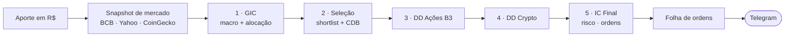

<div align="center">

# Investimentos Manual

**Um comitê de investimentos multipersona (IA) que transforma um aporte em uma folha de ordens acionável — rodando 100% na sua máquina.**


</div>

Você informa quanto vai aportar. Um agente autônomo convoca uma **mesa de
investimentos** (estilo Goldman Sachs GIR + Morgan Stanley GIC + Bridgewater +
AQR), pesquisa o mercado ao vivo, debate em cinco etapas encadeadas e devolve
**onde investir e quanto** — direto no seu Telegram. Você só registra o que comprou.

O universo é restrito a **três classes**: CDB, ações da B3 e crypto. Tudo roda
local (FastAPI + SQLite + Next.js); nada de nuvem, login ou banco externo.

---

## Índice

- [Como funciona](#como-funciona)
- [Mandato de ativos](#mandato-de-ativos)
- [Quick start](#quick-start)
- [Uso no dia a dia](#uso-no-dia-a-dia)
- [Ciclos e automação](#ciclos-e-automação)
- [Autonomia do agente](#autonomia-do-agente)
- [As 5 etapas](#as-5-etapas)
- [Configuração](#configuração)
- [Estrutura do projeto](#estrutura-do-projeto)
- [Comandos úteis](#comandos-úteis)
- [Requisitos](#requisitos)
- [Aviso](#aviso)

---

## Como funciona



As cinco etapas rodam **numa única sessão Claude encadeada** — cada uma herda o
contexto (e o JSON estruturado) da anterior, como num comitê de verdade. A folha
de ordens final é agnóstica de corretora: você decide onde executar.

Dois modos:

- **Automático (padrão)** — o agente roda tudo headless no `claude` (Opus · max
  reasoning), com carta branca de pesquisa, e entrega a recomendação no Telegram.
- **Manual (fallback)** — o app gera os 3 prompts para você colar à mão no Claude.

---

## Mandato de ativos

Três classes, **apenas** — o comitê não analisa nem recomenda nada fora disso:

| Classe | Escopo | Observação |
|---|---|---|
| ✅ **Renda Fixa** | 100% **CDB** (preferência ≥100% do CDI) | Liquidez diária — é o *dry powder* que a revisão semanal pode girar para oportunidades |
| ✅ **Ações** | Só **equities da B3** (large/mid/small) | Análise fundamentalista + forense + técnica |
| ✅ **Crypto** | **Agressivo**: BTC/ETH core + alts L1/L2, DeFi, AI, RWA | Alto upside com gestão de risco; exposição a USD só via stablecoin (USDC) |

**Fora do mandato:** Tesouro Direto, LCI/LCA, debêntures, CRI/CRA, fundos, FIIs,
ETFs (GOLD11/BOVA11/IVVB11), BDRs, ouro, ativos internacionais diretos.

> O mandato é **nativo** dos 3 prompts: todo o universo analisado é CDB · Ações
> B3 · Crypto — não há análise de classes fora do escopo, só sai do mandato em
> linhas explícitas de veto.

---

## Quick start

```bash
./install.sh    # primeira vez: cria venv, instala deps, cria atalho no Desktop
./start.sh      # sobe backend + frontend (+ bot Telegram) e abre o navegador
```

Ou clique no atalho **Investimentos Manual** no Desktop.

Configuração única do Telegram (recomendado):

```bash
# 1. defina TELEGRAM_BOT_TOKEN no .env (token do @BotFather)
# 2. mande /start ao seu bot e capture o chat_id:
.venv/bin/python scripts/telegram_setup.py
# 3. instale os crons (revisão semanal + maturidade + auto-retomada):
scripts/install_cron.sh
```

---

## Uso no dia a dia

### Pelo Telegram (mais prático)

Com o `./start.sh` rodando, o bot sobe junto e responde **só ao seu chat**:

```
/aporte 5000                      roda o comitê e devolve a folha de ordens aqui
/comprei PETR4 acoes 100 38,50    registra a compra (cada compra = um lote)
/carteira                         posições + o que já pode ser vendido (por lote)
/vender PETR4                     vende o lote mais antigo já liberado (≥30 dias)
/revisao                          dispara a revisão semanal do comitê agora
/relatorios                       últimos relatórios (semanais + maturidade)
/status   ·   /ajuda
```

### Pelo terminal

```bash
.venv/bin/python scripts/run_analysis.py --amount 5000
# retomar um aporte interrompido:  --contribution-id <uuid>
# teste barato (sem gastar Opus):  --model haiku --effort low
```

### Pelo dashboard

`/aporte` → **"Adicionar aporte e rodar análise"** e acompanhe etapa por etapa.
`/ativos` gerencia a carteira por lote; `/relatorios` guarda todo o histórico.

> ⚠️ Cada run é Opus/max em 5 etapas + fechamento, com pesquisa ao vivo — custa
> alguns dólares e leva dezenas de minutos. Use `--model haiku --effort low`
> para testar o encanamento de graça.

---

## Ciclos e automação

| Ciclo | Quando | O que faz |
|---|---|---|
| **Aporte** | Ad-hoc (quando você quiser) | 5 etapas encadeadas → folha de ordens → Telegram |
| **Revisão semanal** | A cada 7 dias (cron) | Macro + desempenho das posições + rotação de CDB para oportunidades |
| **Maturidade** | Quando um lote de ação/crypto cruza 30 dias | Comitê reavalia manter / vender / aumentar |

- **Trava de venda por lote (30 dias):** cada compra matura na sua própria data;
  vale só para ações e crypto. **CDB tem liquidez diária** (vende quando quiser).
- **Auto-resume (no processo):** se bater o limite de uso, o agente espera o reset
  e retoma a mesma etapa sozinho, na mesma sessão.
- **Auto-retomada entre reinícios:** se o processo cair no meio (créditos/queda),
  **o sistema retoma sozinho** — `scripts/resume_pending.py` (no cron a cada 15 min)
  detecta a análise incompleta e a conclui assim que o limite voltar, continuando
  exatamente de onde parou. Um lock por aporte impede rodar em dobro.

---

## Autonomia do agente

No modo automático o agente roda num **workspace persistente próprio**
(`storage/agent_workspace/`, fora do git) com carta branca real:

- **Acesso total à máquina** (`--dangerously-skip-permissions` + `--add-dir $HOME`):
  pesquisa qualquer fonte (WebSearch/WebFetch/Bash), lê/escreve arquivos e cria
  suas próprias ferramentas em `tools/` (versionadas em git).
- **Memória própria** que ele gerencia entre ciclos (`MEMORY.md` + grafo de
  conhecimento) — teses vigentes, tickers e CoinGecko-ids validados, lições.
- **MCPs de pesquisa** já carregados: `sequential-thinking`, `filesystem`, `fetch`,
  `context7`, `playwright`, `memory`, `time`, `git`.
- **Auto-provisionamento:** precisa de um MCP novo? Ele adiciona em
  `.mcp.agent.json` e o servidor carrega no ciclo seguinte (o arquivo é dele,
  nunca é sobrescrito). Os MCPs pessoais (Gmail/Calendar/Drive) ficam **de fora**
  de propósito — o agente é autônomo.

---

## As 5 etapas

Cada aporte roda 5 etapas encadeadas + um fechamento, numa única sessão. A
pesquisa (antes uma reunião só) foi dividida em **seleção → DD de ações → DD de
crypto**, para que cada nome da shortlist receba um turno dedicado de análise
profunda em vez de competir por espaço num único prompt gigante.

| # | Etapa | Personas | Foco |
|---|---|---:|---|
| 1 | **GIC — Macro + Alocação Tática** | 12 | Top of Mind, macro BR + global, curva DI/CDB, setores B3, on-chain crypto, Black-Litterman, alocação por classe |
| 2 | **Universo, Filtros e Seleção** | 12 + 2 | Long lists, filtros (quant + forense), seleção da shortlist (5-8 ações + 3-5 cryptos) e **CDB final** com credit analysis |
| 3 | **Due Diligence de Ações B3** | equity desk | Memo completo por ação: tese, valuation triangulada, forense, técnica, factor, bull/base/bear |
| 4 | **Due Diligence de Crypto** | crypto desk | Memo completo por cripto: tokenomics + unlocks, on-chain, derivativos, dev activity, bull/base/bear |
| 5 | **Investment Committee Final** | 14 | Risco (VaR/CVaR/EVT), stress 8 cenários, sentimento, imposto e **folha de ordens** |

Cada etapa exige **JSON estruturado** ao final, com validações obrigatórias e
fontes datadas (URL + data), e instrui o uso de `WebSearch`/`WebFetch`/`Bash`
para checar tudo ao vivo (Glassnode, CryptoQuant, Coinglass, Fundamentus,
StatusInvest, BCB, etc.). As etapas 3 e 4 podem despachar um subagente por nome
para aprofundar cada análise em paralelo.

**Frameworks institucionais aplicados:** GS Top of Mind · GS Asset Allocation ·
MS Capital Market Assumptions · MS GIC On the Markets · Black-Litterman ·
Bridgewater All-Weather / Risk-Parity · AQR Multi-Factor · Fama-French 5 +
Carhart · Damodaran ERP + Country Risk Premium Brazil · Fed Model adaptado (Ibov
earnings yield vs juro real) · HRP (López de Prado) · Markowitz / Max Sharpe /
Min Variance · Kelly fracional.

<details>
<summary><b>Ver todos os modelos quantitativos aplicados</b></summary>

**Forensic accounting (R2):** Piotroski F-Score · Altman Z-Score · Beneish
M-Score · Sloan accruals · Dechow F-Score · Capital Allocation Scorecard
(Buffett-Munger) · Earnings Quality (cash conversion, accruals, SBC, leases
IFRS 16).

**Valuation triangulada (R2):** 3-stage DCF · Reverse DCF · CCA · Precedent
Transactions · LBO check · SOTP.

**Crypto on-chain (R1+R2):** Realized Cap · MVRV-Z · NUPL · SOPR · Puell ·
Reserve Risk · HODL Waves · STH-LTH Cost Basis · CDD · Dormancy · VOCD · RHODL ·
NVT + NVT Signal · Stock-to-Flow · Coinbase/Kimchi Premium · CME Basis · DVOL ·
Funding Rate · Active Developers (Electric Capital).

**Crédito do CDB (R2):** Índice de Basileia Tier 1 · rating do emissor ·
inadimplência (NPL) · ROE · cobertura FGC (R$ 250k/instituição) · %CDI pós-IR.

**Risk quant (R3):** VaR 95%/99% · CVaR (Expected Shortfall) · EVT tail-VaR
(Generalized Pareto) · Marginal/Component VaR · CDaR · Sharpe/Sortino/Calmar ·
Information Ratio · Tracking Error · HHI · Effective N.

**Stress test 8 cenários (R3):** risk-off severo · inflação/juros · Selic +200
bps · crise crypto · crash 2020-tipo · China hard landing · bull dovish · evento
de crédito bancário (testa o FGC).

**Options (R3):** Covered Call · Protective Put · Collar · Cash-Secured Put ·
Vertical/Calendar/Diagonal Spread · Iron Condor (com Greeks).

**Execução (R3):** VWAP · TWAP · POV · Implementation Shortfall · estimativa de
slippage · arredondamento de lote · janelas intra-day.

**Behavioral (R3):** 9 vieses (anchoring, loss aversion, recency, herding,
confirmation, overconfidence, disposition, sunk cost, endowment) + mean reversion
de sentimento (AAII, NAAIM, CNN F&G, Put/Call, IBOV breadth).

**Wealth & tax (R3):** Bucket Strategy · sequence-of-returns · holding com
breakeven · CDB IR regressivo (22.5%→15%) · isenção R$ 20k/mês em ações · crypto
isento até R$ 35k/mês · dividendos B3 · JCP vs dividendo · tax-loss harvesting
(wash-sale 30d) · DARF projetado · reforma 2026.

</details>

---

## Configuração

Edite o `.env` (criado pelo `install.sh` a partir de `.env.example`):

```ini
SQLITE_PATH=storage/portfolio.db
TARGET_FIXED_INCOME=0.35      # alvo de alocação (CDB)
TARGET_STOCKS=0.40            # alvo de alocação (Ações B3)
TARGET_CRYPTO=0.25            # alvo de alocação (Crypto)
MIN_HOLDING_DAYS=30           # trava de venda por lote (ações/crypto; CDB é líquido)
AGENT_MODEL=opus
AGENT_EFFORT=max
COINGECKO_API_KEY=            # opcional (CoinGecko Pro)
TELEGRAM_BOT_TOKEN=           # @BotFather — NUNCA commitar o valor real
TELEGRAM_CHAT_ID=             # preenchido por scripts/telegram_setup.py
```

Os três alvos de alocação devem somar 1.0. Reinicie o backend após editar.

---

## Estrutura do projeto

```
app/
  agents_prompts/    # 5 templates Jinja2 (macro · seleção · DD ações · DD crypto · decisão)
  core/database.py   # SQLite + SQLModel (+ migração leve de colunas)
  models/            # Asset, Contribution, ContributionPrompt, Report
  routers/           # portfolio, contributions, macro, cadence, reports
  services/
    analysis_runner.py   # MOTOR: roda o claude headless, encadeado, com resume
    review_service.py    # revisão semanal + maturidade
    contribution_service.py / prompt_generator.py / market_data_service.py
    portfolio_service.py / telegram_service.py / notification_service.py
scripts/
  run_analysis.py    # aporte → análise (terminal, etapa por etapa)
  resume_pending.py  # retoma análises interrompidas (cron / --watch)
  weekly_review.py · check_cadence.py · telegram_bot.py · telegram_setup.py
  install_cron.sh
frontend/
  src/app/(dashboard)/
    page.tsx         # dashboard + último aporte
    aporte/          # fluxo de aporte (auto-run, etapa por etapa)
    ativos/          # CRUD da carteira (por lote)
    relatorios/      # histórico de aportes + relatórios do agente
    configuracoes/   # leitura do .env
storage/
  portfolio.db       # SQLite (auto-criado)
  agent_workspace/   # workspace persistente do agente (CLAUDE.md, MEMORY.md, tools/)
```

---

## Comandos úteis

```bash
# Backend (dev)
.venv/bin/uvicorn app.main:app --reload

# Frontend (dev)
cd frontend && pnpm dev

# Validações
.venv/bin/ruff check app/ && .venv/bin/ruff format app/
cd frontend && pnpm lint && pnpm type-check && pnpm build

# Inspecionar o banco
sqlite3 storage/portfolio.db
```

---

## Requisitos

- **Python 3.11+** e **Node 20+** com **pnpm** (o `install.sh` instala o que faltar)
- **Claude Code CLI** autenticado (o agente roda o `claude` headless)
- Acesso à internet (BCB, Yahoo Finance, CoinGecko)
- Filesystem **ext4** — NTFS via ntfs-3g não preserva bits de execução e quebra o venv/Node

---

## Aviso

Projeto pessoal de uso local. O comitê de IA é uma ferramenta de **apoio à
decisão**, não recomendação de investimento, oferta ou garantia de resultado.
Os dados vêm de fontes públicas e podem conter erros; valide antes de operar.
Você é o único responsável pelas suas decisões e ordens. Investir em ações e
crypto envolve risco de perda do capital.
